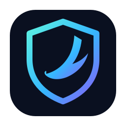
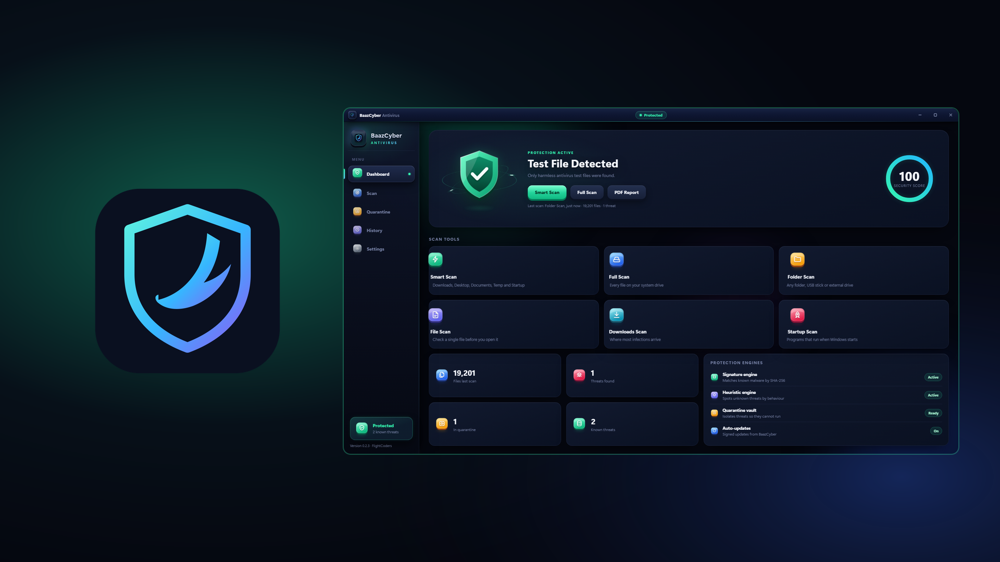
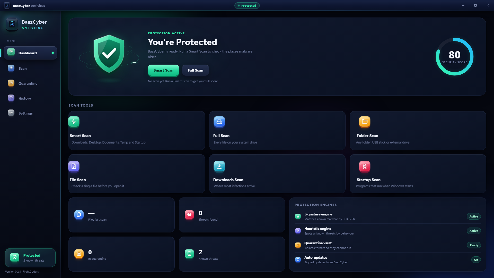
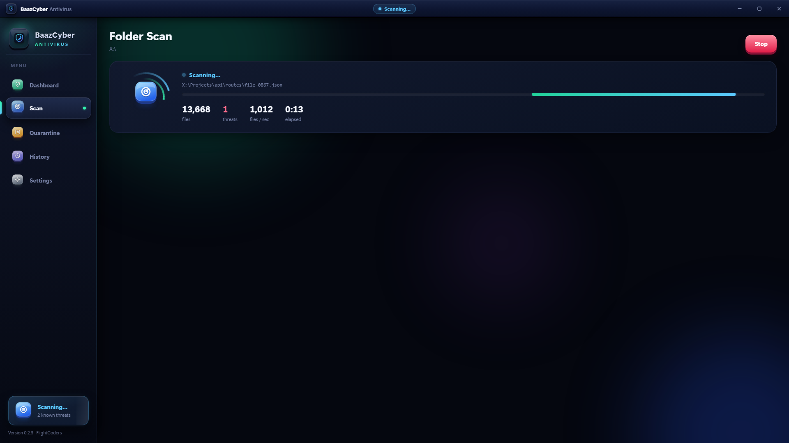
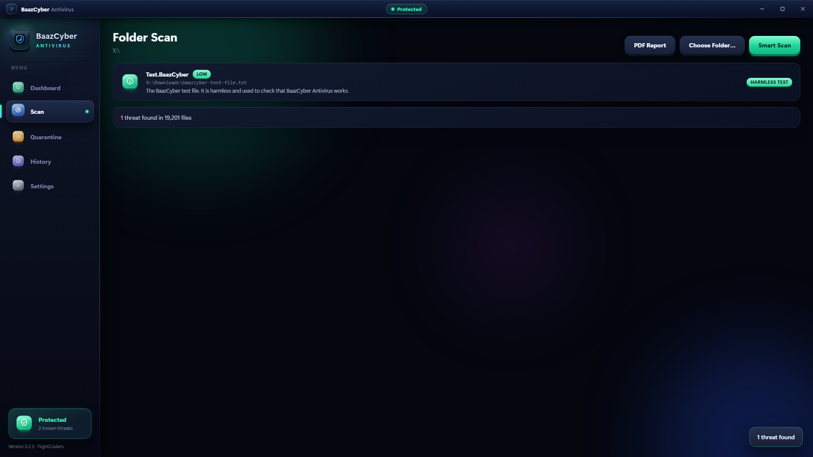
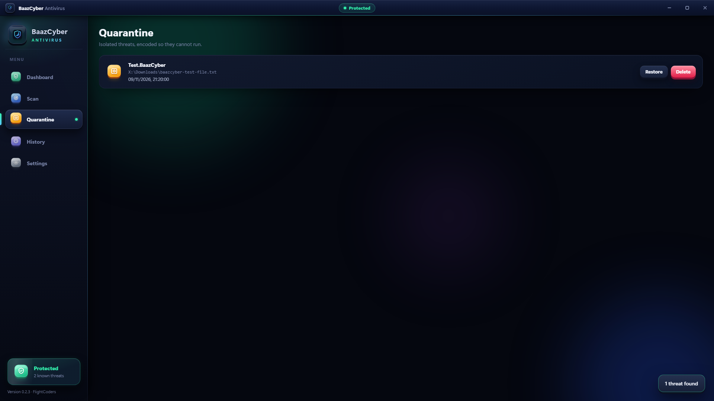
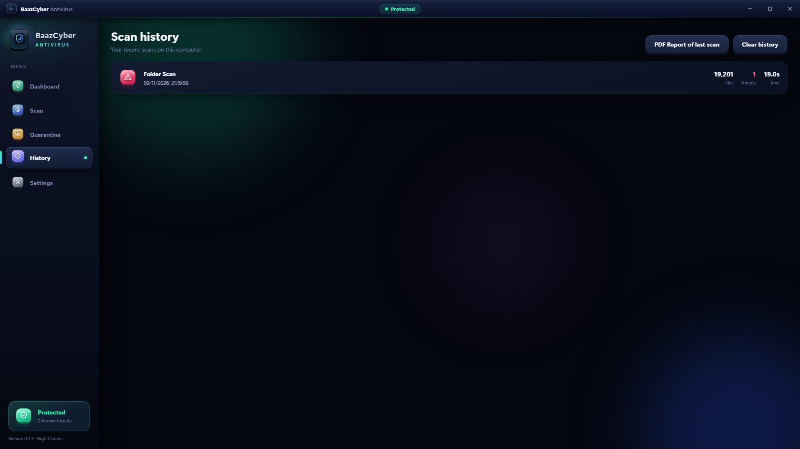
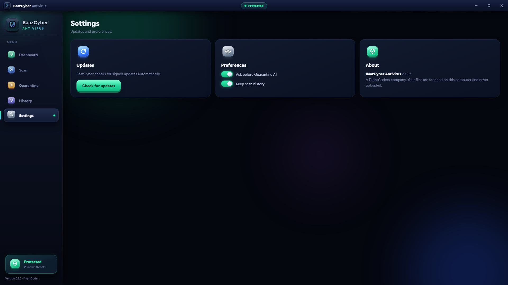

<div align="center">



# BaazCyber Antivirus

**Fast, private malware scanning for Windows.** A **BaazCyber** product, by **FlightCoders**.

[](https://github.com/fcopensource/baazcyber/releases/latest)
[](#download)
[](crates/baaz-engine)
[](app)

[Download](#download) · [Screenshots](#screenshots) · [How it detects threats](#how-it-detects-threats) · [Privacy](https://veyraeditor.com/baazcyber/privacy)



</div>

BaazCyber scans your files for malware, trojans, backdoors and malicious scripts, and quarantines what it
finds. Everything runs on your computer: nothing is uploaded. It runs alongside Windows Defender as an extra
layer; it does not replace it.

## Download

| | |
| --- | --- |
| **Windows installer (.msi)** | [BaazCyber.Antivirus_0.2.3_x64_en-US.msi](https://downloads.veyraeditor.com/baazcyber/v0.2.3/BaazCyber.Antivirus_0.2.3_x64_en-US.msi) |
| **Windows installer (.exe)** | [GitHub release v0.2.3](https://github.com/fcopensource/baazcyber/releases/tag/v0.2.3) |
| **Microsoft Store** | Submitted, coming soon |

Windows 10 and 11, 64-bit. BaazCyber checks for signed updates when it starts and installs them only when you choose.

## Screenshots

| | |
| --- | --- |
|  |  |
| **Dashboard:** security score, six scan types and the protection engines | **Scanning:** about 1,000 files a second, with live progress |
|  |  |
| **Results:** every finding explained in plain words | **Quarantine:** threats encoded so they cannot run; restore or delete |
|  |  |
| **History** of every scan | **Settings** and update status |

*The screenshots show a scan of a demo drive (X:, 19,201 ordinary files plus BaazCyber's harmless test file), using real results from the BaazCyber 0.2.3 engine.*

```
crates/baaz-engine   the scanning engine (Rust, no network): signatures, heuristics, quarantine
crates/baaz-cli      the command-line scanner (baaz)
app/                 the desktop app (Tauri 2: Rust + a dark glass UI)
```

## How it detects threats

A file is checked, in order, against:

1. **Known-malware fingerprints** (SHA-256), loaded from public threat feeds.
2. **Byte signatures**, including the industry-standard **EICAR** test file.
3. **Heuristics** for threats not yet in the database:
   - **File names:** a program dressed as a document (`invoice.pdf.exe`), hidden direction characters, hidden extensions.
   - **Windows programs:** packers, process injection and hollowing, keyloggers, ransomware patterns, crypto miners, anti-debugging.
   - **Scripts** (PowerShell, batch, VBScript, JavaScript, HTA, Python, shell): download-and-run, hidden/encoded PowerShell, reverse shells, disabling Defender or deleting backups, persistence, credential theft, miners.

Each heuristic gives a score and the reason in plain words; a file is reported when the evidence is strong enough.

## Testing it safely

BaazCyber is tested with **EICAR** (the standard harmless antivirus test file) and its own harmless
`BAAZCYBER-ANTIVIRUS-TEST-FILE` marker. No real malware is used anywhere in this project. Note that writing a
real EICAR file to disk makes Windows Defender delete it immediately, so the automated tests use the Baaz marker.

## The command line

```
baaz scan <path>...     Check files or folders
baaz quick              Check the usual places malware arrives
baaz scan <p> --json    Machine-readable output
baaz list               Show quarantined files
baaz restore <id>       Put a quarantined file back
baaz delete <id>        Delete a quarantined file for good
```

Add `--quarantine` to a scan to move every threat somewhere safe.

## The app

A Tauri 2 desktop app with a dark 3D interface: a protection dashboard with a security score; Smart, Full,
Folder, File, Downloads and Startup scans with live progress; a results list that explains every finding; a
quarantine manager; scan history; and PDF security reports.

```
cd app && npm run tauri dev      # run it
cd app && npm run tauri build    # build an installer
```

## Quarantine

A detected file is XOR-encoded (so it can no longer run and other scanners skip it) and stored with a record of
where it came from, under `%LOCALAPPDATA%\BaazCyber\Quarantine`. It can be restored to its original place or
deleted for good.

## What needs more before release

- **Real-time blocking** (stopping a file the instant it runs) needs a Microsoft-signed kernel driver, which
  requires an EV code-signing certificate and Microsoft driver attestation. Until then, BaazCyber scans on
  demand, alongside Defender.
- **Appearing in Windows Security** needs membership of Microsoft's antivirus partner programme.

## Status

Version 0.2.3: the engine, the command-line scanner, quarantine and the desktop app are released, with signed
automatic updates. The Microsoft Store listing assets are in [store/](store). Scanning is on demand, so use it
alongside Windows Defender; it is not a replacement for a full security suite yet.

---

© 2026 BaazCyber, a FlightCoders company.
